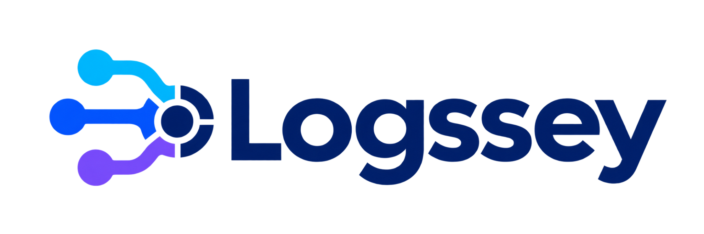

  

  **Unified Cloud Security Operations**

  From Detection to Response.

---

## Overview

클라우드 서비스는 소스코드 작성부터 인프라 구축, 배포와 운영까지 다양한 환경과 기술을 거쳐 제공됩니다. 이 과정에서 자격증명 노출, 코드 및 컨테이너 이미지의 취약점, 인프라 설정 오류, 운영 중 이상 행위 등 서로 다른 보안 위험이 발생합니다.

각 영역의 점검 결과가 여러 도구에 분산되면 보안 담당자는 위험을 파악하는 것뿐 아니라 결과를 취합하고, 대응할 대상을 선정하고, 조치 여부를 확인하는 데에도 많은 시간을 써야 합니다.

**Logssey**는 이러한 과정을 연결하기 위한 **클라우드 통합 보안 관리 플랫폼**입니다. 개발부터 운영까지 발생하는 보안 정보를 한곳에서 확인하고, 반복적인 점검을 자동화하며, 탐지된 위험을 검토와 조치로 이어갈 수 있도록 지원합니다.

특히 보안 전담 인력이 제한적인 환경에서도 중요한 위험에 집중하고 대응 과정을 지속적으로 관리할 수 있도록 하는 것을 목표로 합니다.  
 

## Security Coverage

Logssey는 개발부터 배포, 운영까지 다양한 보안 영역을 통합 관리합니다.

- **Secrets Security** — 자격증명 노출 탐지 및 유효성 검증
- **IaC Security** — 인프라 구성 및 보안 정책 점검
- **Container Image Security** — 컨테이너 이미지 취약점 분석
- **Code Security** — 애플리케이션 코드 취약점 점검
- **Runtime Security** — 컨테이너 이상 행위 탐지
- **Compliance** — 보안 기준 준수 여부 점검
 

## How Logssey Works

**Detect → Integrate → Prioritize → Respond**

1. **Detect** — 코드, 인프라, 컨테이너 이미지 및 운영 환경에서 보안 위험과 이벤트를 수집합니다.
2. **Integrate** — 서로 다른 보안 점검 결과를 하나의 환경에서 확인합니다.
3. **Prioritize** — 위험도와 관련 정보를 바탕으로 대응 우선순위를 판단합니다.
4. **Respond** — 담당자 지정부터 조치 상태 확인까지 대응 과정을 관리합니다.
 

## Repositories

| Repository | Description |
| --- | --- |
| [service-frontend](https://github.com/Logssey/service-frontend) | 통합 대시보드 및 사용자 인터페이스 |
| [service-backend](https://github.com/Logssey/service-backend) | 서비스 백엔드 및 API |
| [infrastructure](https://github.com/Logssey/infrastructure) | AWS·Kubernetes 인프라 및 배포 구성 |
| [service-design-docs](https://github.com/Logssey/service-design-docs) | 서비스 요구사항 및 설계 자료 |
| [security-solution-docs](https://github.com/Logssey/security-solution-docs) | 보안 기능 설계 및 기술 자료 |

---

  Logssey · S-개발자 4기 팀 로그세이 프로젝트

